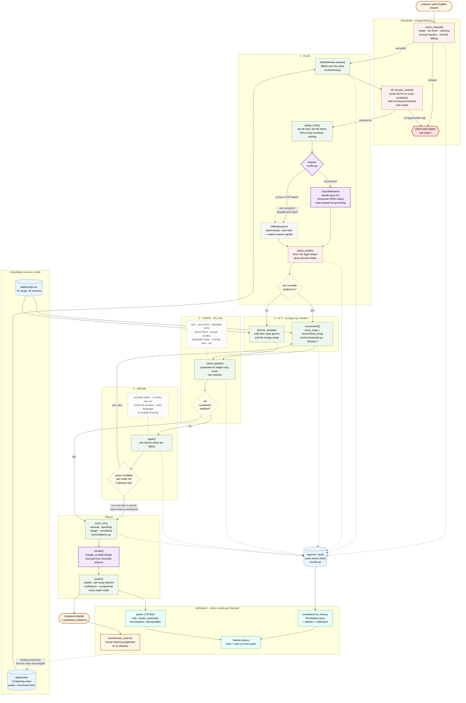
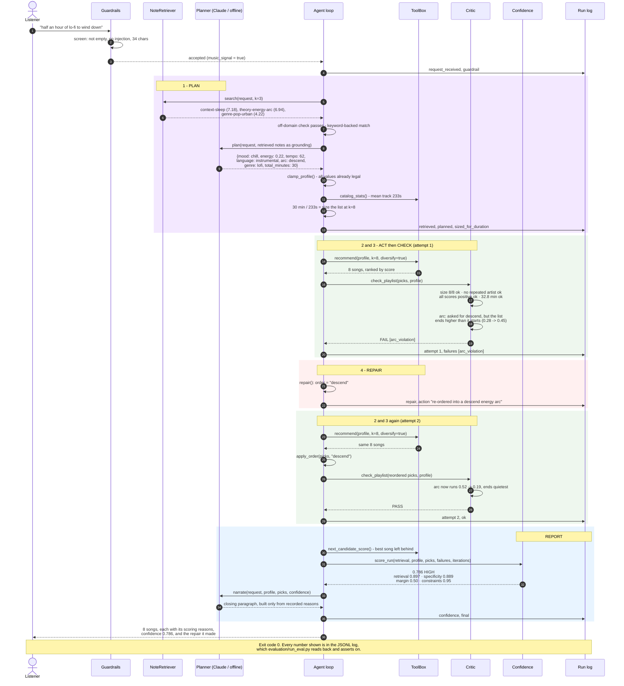

# Architecture diagrams

<!-- Generated by `python diagrams/build_readme.py` from the .mmd sources in this folder.
     Do not edit this file by hand: CI regenerates it and fails if it has drifted. -->

GitHub renders these inline, so they are viewable here without exporting an image. The
authoritative sources are the `.mmd` files alongside this page, which is what the project brief
asks for; this page just wraps each one in a fenced `mermaid` block so it draws in the browser.

To render elsewhere: paste a `.mmd` file into [mermaid.live](https://mermaid.live), or export
an image with
[mermaid-cli](https://github.com/mermaid-js/mermaid-cli) --
`mmdc -i diagrams/architecture.mmd -o assets/architecture.png -b transparent -s 2`.

---

## System architecture

The whole system. The request flows top to bottom through the guardrails, the
plan/act/check/repair loop and out to the listener; the two knowledge sources (the
notes corpus and the song catalog) feed in from the top; dotted lines are writes to
the run log. The `Verification` subgraph at the bottom is where results get checked --
by the test suite, the evaluation harness, human review, and CI.

Source: [`architecture.mmd`](architecture.mmd)

---

## The check-and-repair loop

One real run of `python -m src.app "half an hour of lo-fi to wind down"`, as a
sequence. The first attempt produces a musically sensible list in the wrong order, the
critic catches the arc violation that no per-song score could express, and the repair
fixes it. Every figure in this diagram comes from the committed log for that run,
[`../assets/sample-run-winddown.jsonl`](../assets/sample-run-winddown.jsonl).

Source: [`agent_loop.mmd`](agent_loop.mmd)

